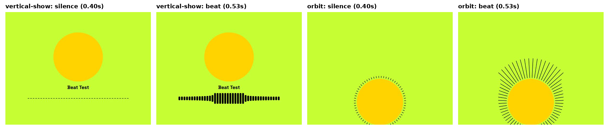
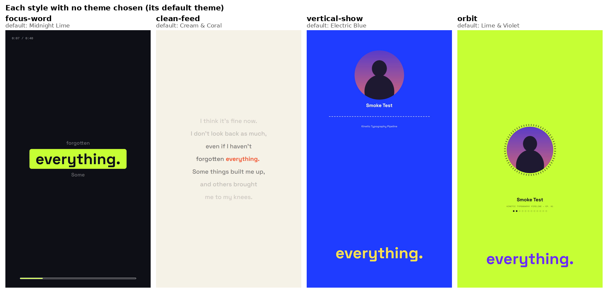
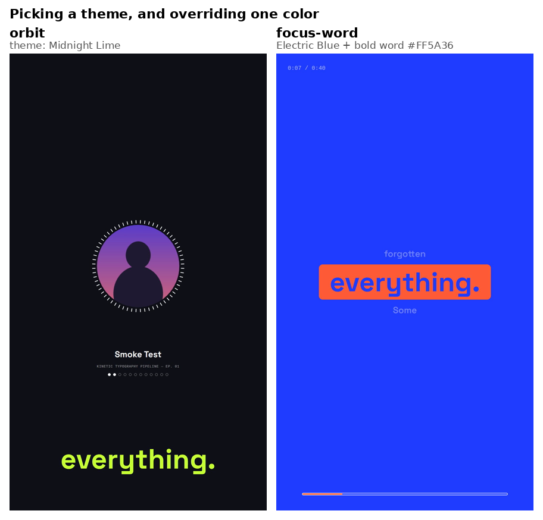

# Kinetic Typography Pipeline

Turns an audio file into a kinetic-typography MP4 (word-synced animated text over a
configurable background), using UniScribe for transcription and Remotion for rendering.

## How it works

```
audio file -> UniScribe (transcribe) -> timestamp parse (+ interpolation fallback)
           -> animation schedule (word cues | line cues) -> Remotion render -> MP4
```

- **Transcription** (`src/uniscribe/client.ts`): uploads the file via UniScribe's
  pre-signed URL flow, creates a transcription job, and either polls
  `GET /api/v1/transcriptions/{id}/status` or waits for a webhook callback.
- **Timestamp parsing** (`src/transcript/parse.ts`): UniScribe returns word-level
  timestamps in `segments[].words[]`. If a given response only has phrase-level
  timestamps, `src/transcript/interpolate.ts` distributes each phrase's duration
  across its words proportionally to word length.
- **Animation schedule** (`src/animation/schedule.ts`): converts the transcript into
  either a flat list of word cues (used by focus-word and the caption strip in
  vertical-show/orbit) or line cues with per-word timing (clean-feed). Transcript segments can be a minute of continuous speech, so
  `src/animation/lines.ts` splits each one into short lyric-length lines — at sentence
  ends, clause punctuation and pauses, then into evenly sized lines if still too long.
- **Rendering** (`src/render/renderVideo.ts` + `remotion/`): bundles the Remotion
  project and renders the composition matching `reveal.style` to MP4 (H.264/AAC).
- **Orchestration**: `src/cli.ts` for one-shot CLI runs, `src/webhook.ts` for an
  HTTP API (direct file upload or n8n-friendly server-side path — full reference in
  [docs/API.md](docs/API.md)). Transcripts are cached to disk keyed by a SHA-256
  hash of the audio file, so re-runs (or a crash after transcription but before
  render) never re-call UniScribe for the same file.

## Setup

```bash
npm install
cp .env.example .env   # fill in UNISCRIBE_API_KEY
```

Verify your UniScribe API key/tier and inspect the real timestamp granularity your
account gets back before relying on it:

```bash
npm run test:uniscribe
```

### Required environment variables (`.env`)

| Variable | Description |
|---|---|
| `UNISCRIBE_API_KEY` | Your UniScribe API key (Basic tier or above required for API access) |
| `UNISCRIBE_BASE_URL` | Defaults to `https://api.uniscribe.co` |
| `CACHE_DIR` | Where transcripts/job-ids are cached (default `./.cache`) |
| `OUTPUT_DIR` | Not read directly — output directory is set in `config/default.yaml` under `output.directory` |
| `WEBHOOK_PORT` | Port for the HTTP API server (default `4000`) |
| `PUBLIC_BASE_URL` | Public URL this container is reachable at — only required if you trigger renders with `mode: "webhook"` |
| `API_KEY` | Optional shared-secret for the HTTP API — see [docs/API.md](docs/API.md#authentication) |
| `LOG_LEVEL` | pino log level (default `info`) |
| `REMOTION_BROWSER_EXECUTABLE` | Optional path to an existing Chrome/Chromium binary to render with. Unset, Remotion downloads its own headless shell on the first render (needs outbound access to `remotion.media`) |

## CLI usage

```bash
npm run cli -- render --input ./data/episode.mp3
npm run cli -- render --input ./data/episode.mp3 --config ./config/presets/lime-show.yaml
npm run cli -- render --input ./data/episode.mp3 --output episode-final.mp4 --language en
npm run cli -- render --input ./data/episode.mp3 --style clean-feed --background blue
npm run cli -- render --input ./data/episode.mp3 --style orbit --theme midnight-lime
npm run cli -- render --input ./data/episode.mp3 --background "#1E88E5" --font-color "#FFFFFF" --highlight-color "#FFD400"
```

`--theme` picks a color theme (see [Color themes](#color-themes)); without it the
style's own default theme is used. `--background` takes either a preset name
(`white`, `black`, `grey`, `silver`, `blue`) or any hex value; `--font-color` /
`--highlight-color` set `text.color` and `text.highlightColor`. Each of these three
overrides just that one color of the theme.

Exit codes are non-zero on any failure, with the failing stage and a human-readable
message logged (see `src/errors.ts` for the full list — invalid API key, plan-tier
access denied, rate limit, unsupported format, empty/failed transcript, render crash).

## HTTP API / n8n usage

Start the server (`npm run webhook`, or via Docker — see below). Full endpoint
reference, request/response shapes, auth, and error handling:
**[docs/API.md](docs/API.md)**.

Two ways to trigger a render:

- **Direct upload** — `POST /render` as `multipart/form-data` with an `audio` file
  field. Works from any HTTP client; no shared filesystem needed.
  ```bash
  curl -X POST http://localhost:4000/render -F "audio=@episode.mp3" -F "style=clean-feed"
  ```
- **Server-side path** — `POST /render` as JSON with `audioFilePath` pointing to a
  file already on the server's filesystem. This is the n8n-friendly mode: write the
  incoming audio into the shared `./data` volume first (e.g. via n8n's "Move Binary
  Data" + "Write Binary File" nodes), then call this endpoint with that path.
  ```json
  { "audioFilePath": "/app/data/episode.mp3", "configOverrides": { "reveal": { "style": "clean-feed" } } }
  ```

Both return `202 { jobId, statusUrl, downloadUrl }` immediately. Poll `GET
/render/:jobId` until `status` is `completed`, then fetch the file from
`GET /render/:jobId/download` (or read `outputPath` directly if you share a volume).

In n8n: an HTTP Request node posts to `/render`, then a polling loop (n8n's "Wait"
node + another HTTP Request) checks `/render/:jobId` until done.

A ready-to-import n8n workflow doing exactly this via a web form — upload an audio
file (plus an optional cover image), pick one of the four styles, set
background/font/highlight colors, wait, and get the finished MP4
back as one synchronous submission — is at
[`n8n/kinetic-render-workflow.json`](n8n/kinetic-render-workflow.json), documented in
[docs/N8N_WORKFLOW.md](docs/N8N_WORKFLOW.md).

## Configuration

All rendering/styling knobs live in `config/default.yaml` (see that file for the full
schema: output resolution/orientation/fps, reveal style, font/colors/stroke/position,
background type, UniScribe poll timing). Override any subset via `--config` (CLI) or
`configOverrides` (webhook) — overrides are shallow-merged per top-level section, no
code changes needed.

### Reveal styles

Exactly four styles are available (anything else is rejected by config validation):

- `focus-word`: one word at a time on a rounded `highlightColor` card, with faded
  previous/next word context above and below, an elapsed/total timer, and a bottom
  progress bar.
- `clean-feed`: continuous flowing lines — several transcript lines visible at once,
  each in a fixed slot that smoothly scrolls up by one line at a time (nothing
  reflows/jumps). Within the current line, the active word is bold and in
  `highlightColor`, already-spoken words in that line are dimmed, upcoming words
  dimmer still.
- `vertical-show`: a "show card" (circular cover image, title, audio waveform,
  description) in the upper frame, with one-word captions in the lower third. Needs
  `show.title` / `show.coverImagePath` / `show.description` (see below).
- `orbit`: circular avatar with a radial audio-spectrum spike ring, title, description
  + episode label, and a chapter/progress dot indicator, with one-word captions in the
  lower third. Needs the same `show.*` fields, plus `show.totalChapters` for the dots.

The `vertical-show` waveform and `orbit` spike ring (and the `waveform` background) are
driven by the audio frame by frame: each frequency band is scaled against how loud that
band gets across the whole track (`remotion/util/useAudioBands.ts`), so beats and
stressed syllables visibly hit on quiet speech as well as loud music, and silence
stays flat.



### Color themes

Each video is generated from a **style** plus a **color theme**. A theme sets three
colors: the background, the text, and the highlight — the current (bold) word in
`clean-feed`/`vertical-show`/`orbit`, the card behind the word in `focus-word`, the
progress bar, and the `waveform` background's bars.

| Theme | Background | Text | Bold word | Default for |
|---|---|---|---|---|
| `midnight-lime` | `#0E0E16` | `#F5F5F7` | `#C6FF34` | `focus-word` |
| `cream-coral` | `#F6F1E7` | `#1B1B1F` | `#FF5A36` | `clean-feed` |
| `electric-blue` | `#1F3BFF` | `#FFFFFF` | `#FFE14D` | `vertical-show` |
| `lime-violet` | `#C6FF34` | `#111111` | `#6A2BFF` | `orbit` |



How the colors are decided, lowest to highest priority:

1. The style's default theme (table above).
2. A chosen theme: `--theme` (CLI), the `theme` field (API), the **Color Theme**
   dropdown (n8n form), or `theme:` in a config file.
3. Any single color set explicitly: `--background` / `--font-color` /
   `--highlight-color`, the `background` / `fontColor` / `highlightColor` fields, or
   `background.color` / `text.color` / `text.highlightColor` in a config file (e.g.
   `config/presets/lime-show.yaml`). This replaces just that color and keeps the rest
   of the theme.



Every style against every theme, for comparison:
[docs/screenshots/color-options.png](docs/screenshots/color-options.png). To add a
theme, add it to `COLOR_THEMES` in `src/themes.ts` and to the Color Theme dropdown in
`n8n/kinetic-render-workflow.json`; change a style's default in `STYLE_DEFAULT_THEME`.

`vertical-show` and `orbit` already draw their own waveform/spectrum — pair them with
`background.type: solid` or `gradient`, not `waveform` (both would render). A ready-made
solid lime-green/dark-text look matching that combination is in
`config/presets/lime-show.yaml`:

```bash
npm run cli -- render -i data/episode.mp3 --config config/presets/lime-show.yaml --style orbit --title "Sarah Connor" --cover-image data/sarah.jpg --description "On Building Calm Software" --episode-label "EP. 12"
```

### Show metadata (`show.*`, and `--title` / `--cover-image` / `--description` / `--episode-label`)

Only used by `vertical-show` and `orbit`; ignored by `focus-word` and `clean-feed`.

| Field | CLI flag | Default when unset |
|---|---|---|
| `show.title` | `--title` | audio filename (without extension) |
| `show.coverImagePath` | `--cover-image` | none — renders a solid placeholder circle in `highlightColor` |
| `show.description` | `--description` | hidden if unset |
| `show.episodeLabel` | `--episode-label` | hidden if unset |
| `show.totalChapters` | — (config only) | `12` — dot count in the Orbit progress indicator |

Via the webhook, set these under `configOverrides.show` in the `POST /render` body
instead of dedicated fields.

### Background types

- `solid` — flat `background.color`. Set it with `--background <color>` (CLI) or the
  `background` field (webhook/n8n) — either a preset (`white`, `black`, `grey`,
  `silver`, `blue`) or any hex value like `#1E88E5`; unset, it comes from the
  [color theme](#color-themes). Also used as the `waveform` type's backdrop. Ignored
  by `gradient`/`video`.
- `gradient` — linear gradient between `background.gradient.from`/`to` at `angle` degrees.
- `video` — looping video or static image; set `background.mediaPath` to a file path
  (it's copied into `remotion/public/backgrounds/` automatically at render time).
- `waveform` — animated audio-amplitude bars in `background.waveform.color` over
  `background.color`, driven by `@remotion/media-utils`. The bars occupy a strip along
  the bottom of the frame, and every reveal style's text is laid out above that strip
  (and clipped to it), so text never draws over the bars.

### Extending

- **New reveal style**: add a composition under `remotion/compositions/`, register it
  in `remotion/Root.tsx`, add the style to `RevealStyle` in `src/types.ts` and to
  `REVEAL_STYLE_TO_COMPOSITION` in `src/render/renderVideo.ts`. It'll get the flat
  word-cue shape from `src/animation/schedule.ts` automatically unless you add it to
  `LINE_BASED_STYLES` there (for line grouping instead). Also add it to
  `REVEAL_STYLE_CATALOG` (`src/api/styleCatalog.ts`), the zod enum in `src/config.ts`,
  and the Style dropdown in `n8n/kinetic-render-workflow.json`.
- **New background type**: add a component under `remotion/backgrounds/`, wire it
  into `remotion/backgrounds/Background.tsx`'s switch, and extend the `background`
  section of `config/default.yaml` + the zod schema in `src/config.ts`.
- **Fonts**: `text.font` defaults to "Space Grotesk", actually loaded via
  `@remotion/google-fonts` in `remotion/shared/fonts.ts` (not just a CSS
  font-family string) so it renders correctly in headless Chrome without depending
  on the OS having it installed. Any other configured font name falls back to a
  generic system-font stack. To wire up a different Google Font the same way, swap
  the import in `fonts.ts` for another `@remotion/google-fonts/<FontName>` subpackage.

## Testing

```bash
npm run typecheck        # TypeScript across src/, remotion/ and scripts/
npm run test:uniscribe   # checks your UniScribe key/plan and timestamp granularity (needs UNISCRIBE_API_KEY)
npm run test:render -- orbit solid   # renders output/smoketest-orbit-lime-violet-solid.mp4, no UniScribe call
```

`test:render` takes `[style] [background-type] [background-color]` (style is one of
`focus-word`, `clean-feed`, `vertical-show`, `orbit`) and renders a ~40s clip from a
synthetic transcript over `data/smoketest.wav`. Optional env vars:
`SMOKETEST_THEME` (a theme name; unset uses the style's default),
`SMOKETEST_FONT_COLOR`, `SMOKETEST_HIGHLIGHT_COLOR` (hex), `SMOKETEST_COVER_IMAGE`
(path to the image shown by `vertical-show`/`orbit`), and
`SMOKETEST_ORIENTATION=horizontal`. To check all four styles in a theme with your own
image:

```bash
for s in focus-word clean-feed vertical-show orbit; do
  SMOKETEST_THEME=midnight-lime SMOKETEST_COVER_IMAGE=data/cover.jpg npm run test:render -- $s solid
done
```

To check the API end to end, start it with `npm run webhook` and:

```bash
curl localhost:4000/health
curl localhost:4000/styles           # revealStyles lists exactly the four styles
curl -X POST localhost:4000/render -F "audio=@data/smoketest.wav" -F "cover=@data/cover.jpg" \
  -F "style=orbit" -F "theme=midnight-lime"
```

A removed style (e.g. `style=karaoke`), an unknown theme, or a non-hex color returns
`400` with the reason.

## Docker

```bash
cp .env.example .env   # fill in UNISCRIBE_API_KEY, PUBLIC_BASE_URL if using webhook mode
docker compose up -d --build
```

Drop audio files into `./data` on the host (mounted at `/app/data` in the container)
before calling `POST /render` with that in-container path. Rendered MP4s land in
`./output` on the host.

For one-off CLI renders inside the same image:

```bash
docker compose run --rm kinetic-typography npx tsx src/cli.ts render -i /app/data/episode.mp3
```

## Known open items (flagged per the original requirements doc)

- UniScribe's public OpenAPI docs (confirmed at build time) document word-level
  timestamps in `segments[].words[]`; `npm run test:uniscribe` re-verifies this
  against your actual account/plan before you rely on it, since the docs are
  marked "Beta" and may drift.
- Rate limits are documented as 60 req/min / 1000 req/day per API key — the client
  surfaces `429`s as `RateLimitError` but does not currently auto-retry with backoff;
  add that in `UniScribeClient.request` if you hit it in practice.
- Remotion was chosen over the FFmpeg `drawtext`/ASS-subtitle fallback: it gives full
  React-based control over per-word animation (spring easing, active-word highlighting,
  waveform visualization) without hand-rolling ASS timing math, at the cost of a
  heavier Docker image (headless Chromium) and slower render-per-second-of-video
  than pure FFmpeg filters. Revisit if VPS CPU/RAM becomes a bottleneck on long files.
